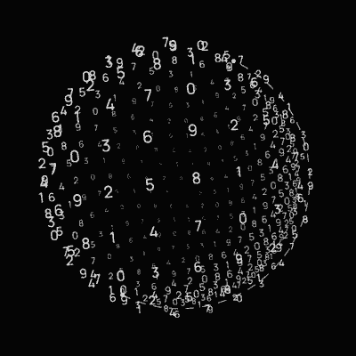

  

  <h2>Oi, eu sou a Thayrina 👋</h2>
  
Estudante de <b>Engenharia de Software</b> (3º período) · programando em C, mexendo com banco de dados e criando automações com IA

---

### 🛠️ Tecnologias

### 📜 Certificação

- **Curso de Banco de Dados** — Oracle

### 🚀 Projetos em destaque

| Projeto | O que é |
|---|---|
| 🤖 **Automação de vendas (Mercado Phone)** | Lê as vendas registradas no WhatsApp de uma loja de celulares e lança tudo automaticamente no sistema de gestão via API, com relatório em PDF. Desenvolvida com IA (Claude). |
| 💻 [**laboratorio-programacao-c**](https://github.com/thayrinacs/laboratorio-programacao-c) | Exercícios e atividades de Laboratório de Programação em C. |

### 🌱 Aprendendo agora

- Estruturas de dados em C
- Modelagem e consultas SQL mais avançadas no PostgreSQL
- Integrações com IA e APIs

### 📫 Contato

