  

&nbsp;

 

### Projetos

**[Programa ARCA — Prefeitura Municipal da Serra/ES](https://github.com/thayrinacs/programa-ARCA)** · [ver aplicação](https://thayrinacs.github.io/programa-ARCA/) 
Projeto interdisciplinar de Engenharia de Software (UVV, 2026) para o programa de bem-estar animal da Prefeitura da Serra: agendamento de castração gratuita, denúncia anônima de maus-tratos, adoção responsável e integração com ONGs parceiras. Pesquisa de UX e protótipo no Figma e Miro, modelagem em PostgreSQL e Single Page Application publicada no GitHub Pages. Selecionado entre os projetos da turma para apresentação à Prefeitura.

**Automação de lançamento de vendas — Mercado Phone** 
Sistema que coleta as vendas registradas em canal de atendimento de uma loja de celulares e as lança automaticamente no sistema de gestão por meio de API, gerando relatório em PDF. Desenvolvido com apoio de inteligência artificial.

**[Programação em C](https://github.com/thayrinacs/laboratorio-programacao-c)** 
Implementações em C abordando ponteiros, structs, manipulação de arquivos, modularização com bibliotecas próprias (`.h`), matrizes, strings e funções. Inclui aplicações como sistema de cadastro de funcionários e controle de assentos.

### Formação

- **Engenharia de Software** — Universidade Vila Velha (UVV), graduação em andamento (3º período)
- **Database Foundations** — Oracle Academy, certificado de conclusão (jul/2026)
